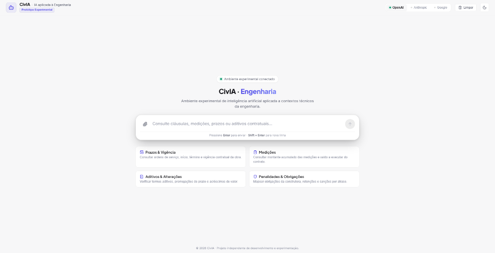
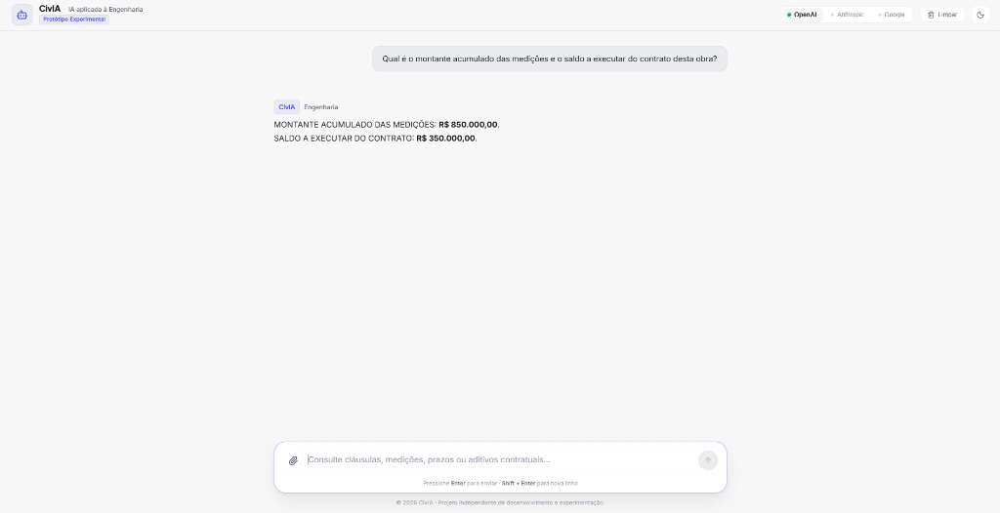
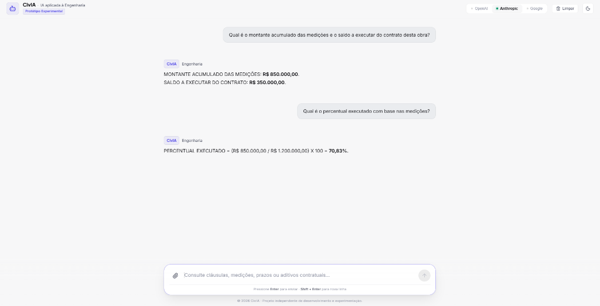

# CivIA — AI Applied to Civil Engineering

> **Independent research and software development initiative exploring the application of artificial intelligence in technical engineering environments.**

🌐 **Language:** [English](#english) | [Português (Brasil)](#portugues-brasil)

---

## English

### 1. About the Initiative

**CivIA** is an independent research and software development initiative exploring the application of artificial intelligence in Civil Engineering.

The initiative brings together civil engineering expertise and software development practices to investigate new possibilities for applying AI in technical environments.

This repository provides an institutional overview of CivIA and selected demonstrations of its development.

---

### 2. Core Competencies

- **Python & Software Development:** Modular development, typing, and software engineering practices.
- **Generative AI Applications:** Working with large language models and AI-powered applications.
- **Web Application Development:** Building dynamic interfaces focused on usability and clear communication.
- **Engineering Domain Knowledge:** Applying civil engineering expertise to organize and evaluate technical information.

---

### 3. Demonstration

In complex technical environments, critical information can easily be overlooked or scattered across disparate documents, leading to decisions made without full contextual visibility.

Explore a demonstration of how CivIA approaches this challenge:

🎥 **[Watch the demonstration on LinkedIn](https://lnkd.in/p/dzugkSXK)**

#### Interface Overview

*Initial application interface with suggested technical domains.*

*Contextual query on contractual values and cumulative execution balance.*

*Conversational continuity and calculated execution percentage.*

---

### 4. Technologies & Areas

- **Programming:** Python
- **Artificial Intelligence:** Generative AI and Large Language Models (LLMs)
- **Software Development:** Web Applications
- **Application Domain:** Civil Engineering

---

### 5. Project Status

> **Status:** Ongoing independent research and development initiative.

This repository serves exclusively as an institutional showcase and professional portfolio. The complete implementation and internal development assets remain private.

---

### 6. Professional Profile

Developed by **Maiky Rayan**, Civil Engineer focused on the intersection of engineering expertise, software development, and artificial intelligence.

💼 **[Connect on LinkedIn](https://www.linkedin.com/in/maiky-rayan)**  
📍 Brazil

---

## Português (Brasil)

### 1. Sobre a Iniciativa

O **CivIA** é uma iniciativa independente de pesquisa e desenvolvimento de software que explora aplicações de inteligência artificial na Engenharia Civil.

A iniciativa integra conhecimentos de engenharia civil e práticas de desenvolvimento de software para investigar novas possibilidades de aplicação da IA em ambientes técnicos.

Este repositório apresenta uma visão institucional do CivIA e demonstrações selecionadas de seu desenvolvimento.

---

### 2. Competências Principais

- **Python e Desenvolvimento de Software:** Desenvolvimento modular, tipagem e boas práticas de engenharia de software.
- **Aplicações de IA Generativa:** Trabalho com modelos de linguagem e aplicações baseadas em inteligência artificial.
- **Desenvolvimento de Aplicações Web:** Construção de interfaces dinâmicas com foco em usabilidade e clareza de comunicação.
- **Conhecimento de Domínio em Engenharia:** Aplicação de conhecimentos de engenharia civil na organização e análise de informações técnicas.

---

### 3. Demonstração

Em ambientes técnicos complexos, informações relevantes podem passar despercebidas ou estar dispersas, o que pode levar a decisões sem uma visão completa do contexto.

Conheça uma demonstração de como o CivIA explora esse desafio:

🎥 **[Assistir à demonstração no LinkedIn](https://lnkd.in/p/dzugkSXK)**

#### Visão da Interface

*Tela inicial da aplicação com tópicos técnicos sugeridos.*

*Consulta de valores contratuais e saldo acumulado de medições.*

*Continuidade de raciocínio e cálculo do percentual executado.*

---

### 4. Tecnologias e Áreas

- **Programação:** Python
- **Inteligência Artificial:** IA Generativa e Modelos de Linguagem (LLMs)
- **Desenvolvimento de Software:** Aplicações Web
- **Domínio de Aplicação:** Engenharia Civil

---

### 5. Status do Projeto

> **Status:** Iniciativa independente de pesquisa e desenvolvimento em andamento.

Este repositório possui finalidade estritamente institucional e demonstrativa. A implementação integral e os materiais internos de desenvolvimento permanecem privados.

---

### 6. Perfil Profissional

Desenvolvido por **Maiky Rayan**, engenheiro civil com foco na integração entre engenharia, desenvolvimento de software e inteligência artificial aplicada.

💼 **[Conectar no LinkedIn](https://www.linkedin.com/in/maiky-rayan)**  
📍 Brasil

---

&copy; 2026 CivIA · Pesquisa e Desenvolvimento Independente.
